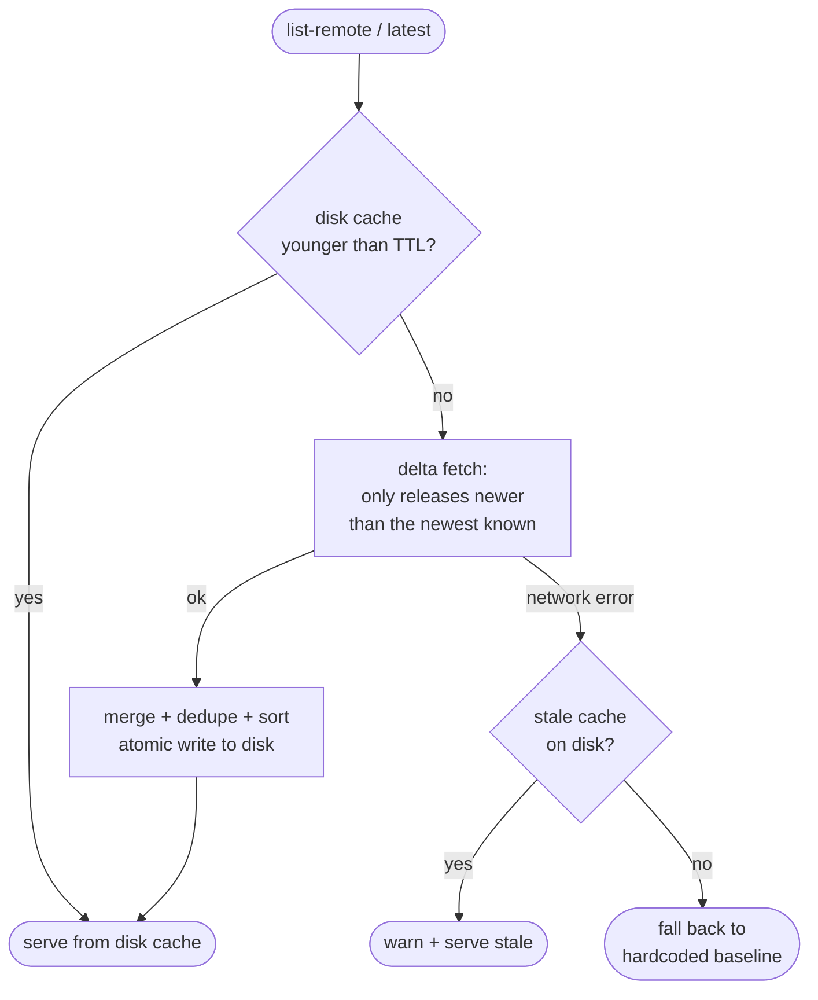
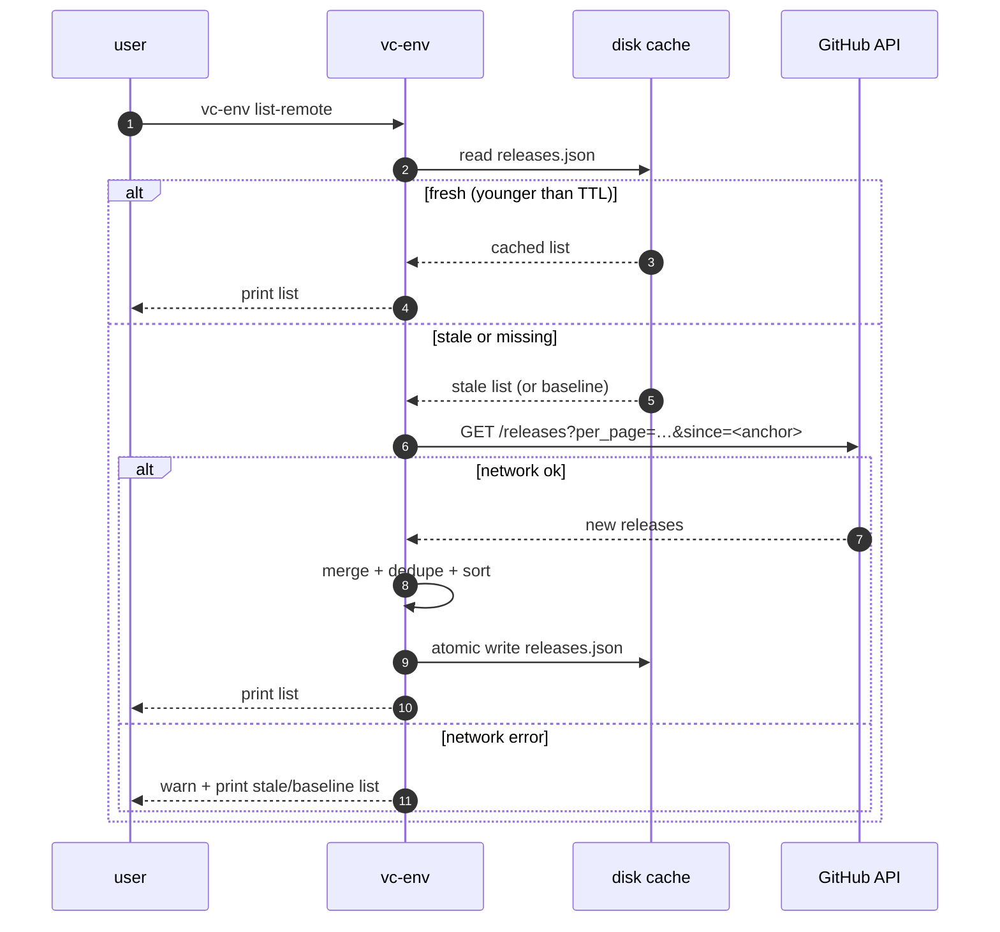

# Caching strategy in `vc-env`

`vc-env` uses a three-layer caching strategy for the list of available
`vcluster` versions. With this cache, commands like `list-remote` and
`latest` stay fast and reliable. They also respect the GitHub API rate
limits.



## 1. The three layers

### Layer 1: Hardcoded baseline
The `vc-env` binary contains a hardcoded list of known stable and pre-release versions (see `internal/cache/baseline.go`).

The baseline gives a useful starting point with zero latency, even on the very first run.
If both the disk cache and the network are unavailable, `vc-env` uses the baseline as the last fallback.
The newest version in this list is the "anchor" for the first delta fetch.

### Layer 2: Disk cache
When `VCENV_ROOT` is set, `vc-env` saves the merged list of versions to a JSON file at
`$VCENV_ROOT/cache/releases.json`.

If the cache file is younger than the TTL (time to live), `vc-env` uses it immediately and makes no network calls.
`vc-env` writes the cache to a temporary file and then renames it.
As a result, concurrent processes never read a partially written file.

### Layer 3: Delta fetch
If the disk cache is stale (older than the TTL) or missing, `vc-env` does a "delta fetch" from the GitHub API.

A delta fetch requests only the releases newer than the most recent version in the stale cache (or the baseline).
`vc-env` automatically merges the new releases with the known versions. Then it removes duplicates and sorts the list.
If the network is unavailable during a delta fetch, `vc-env` prints a warning.
Then it falls back to the stale cache or the hardcoded baseline.

From the client's point of view, a delta fetch looks like this:



## 2. Configuration

Use these environment variables to configure the cache:

| Variable | Description | Default |
|----------|-------------|---------|
| `VCENV_ROOT` | Root directory for `vc-env`. If it is not set, the cache is in memory only (nothing is saved to disk). | N/A |
| `VCENV_CACHE_TTL` | How long a cache entry stays fresh. Takes a Go duration string (e.g., `1h`, `30m`, `24h`, `0s`). | `1h` |

!!! tip "Disabling the cache"
    To force a fresh fetch every time, set the TTL to zero:

    ```bash
    export VCENV_CACHE_TTL=0s
    ```

    `vc-env` still writes to disk after a successful fetch. But it never
    treats the on-disk copy as fresh.

## 3. Storage format

The cache file (`releases.json`) has these fields:

*   `fetched_at`: UTC timestamp of the last successful fetch.
*   `versions`: List of stable versions (newest first).
*   `prerelease_versions`: List of all versions, including pre-releases (newest first).

## 4. Maintenance

Maintainers should update the hardcoded baseline from time to time, for example when they release a new version of `vc-env`.
This keeps the "lower bound" reasonably close to the current releases.
But even if the baseline is far out of date, delta fetches correct the list automatically.
