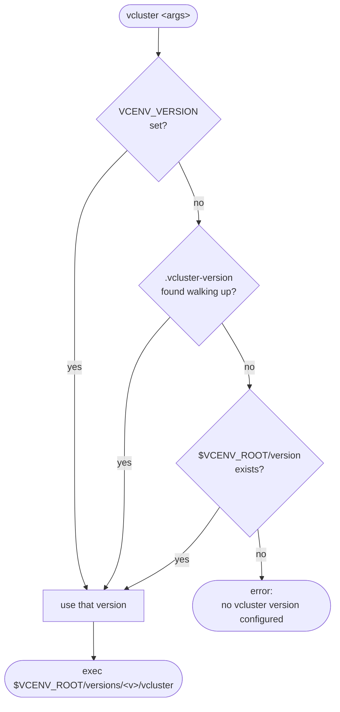

# Installation and configuration

This guide covers supported platforms, install methods, required setup steps, how `vc-env` finds its configuration, and common troubleshooting.

## Supported platforms

The project currently builds prebuilt binaries for these platforms:

- `darwin/amd64`
- `darwin/arm64`
- `linux/amd64`
- `linux/arm64`

If your platform is not listed, install from source.

## Prerequisites

- A POSIX-like shell (e.g. `bash` or `zsh`).
- Permission to create and write files in your chosen `VCENV_ROOT` directory.
- Network access to GitHub:
    - `vc-env install`, `vc-env latest`, and `vc-env list-remote` fetch information from GitHub.

You do not need an existing `vcluster` installation. `vc-env` manages the `vcluster` binaries that it installs.

## Install methods

=== "Prebuilt binary (recommended)"

    1. Download the binary for your platform from the project's
       [GitHub releases](https://github.com/mmpyro/vc-env/releases).
    2. Make it executable.
    3. Move it into a directory on your `PATH`.

    Example (Linux x86_64):

    ```sh
    curl -L -o vc-env https://github.com/mmpyro/vc-env/releases/download/v1.2.0/vc-env-linux-amd64
    chmod +x vc-env
    sudo mv vc-env /usr/local/bin/vc-env
    ```

=== "Build from source"

    ```sh
    git clone https://github.com/mmpyro/vc-env.git
    cd vc-env
    make build
    ```

    The binary is then at `build/vc-env`.

=== "Cross-compile for all platforms"

    ```sh
    make build-all
    ```

    This command builds `build/vc-env-<os>-<arch>` for `linux/amd64`,
    `linux/arm64`, `darwin/amd64` and `darwin/arm64`.

## Initial setup

### 1) Choose and export `VCENV_ROOT`

`VCENV_ROOT` is required. It defines where `vc-env` stores installed versions, the shim, and the global version file.

Add this line to your shell profile (e.g. `~/.bashrc` or `~/.zshrc`):

```sh
export VCENV_ROOT="$HOME/.vcenv"
```

Required permissions:

- `vc-env init` creates directories under `$VCENV_ROOT`.
- `vc-env install` writes `vcluster` binaries under `$VCENV_ROOT/versions/<version>/vcluster`.
- `vc-env global` writes `$VCENV_ROOT/version`.

### 2) Initialize shell integration

Add this line to your shell profile (e.g. `~/.bashrc` or `~/.zshrc`),
after the `VCENV_ROOT` export:

```sh
eval "$(vc-env init)"
```

What this line does:

- It prepends `$VCENV_ROOT/shims` to your `PATH`, so `vcluster` resolves to the shim.
- It defines a `vc-env` shell function. This function lets `vc-env shell` change the current shell environment.

!!! note "Why `eval` and not just a `source`"
    `vc-env init` prints shell code to stdout. `eval` applies this code to
    the current shell. This lets `vc-env shell <version>` export
    `VCENV_VERSION` for your interactive session.

### 3) Install a `vcluster` version

```sh
vc-env install 0.21.1
```

Or install the latest stable version:

```sh
vc-env install
```

### 4) Configure which version to use

Choose one of these options:

=== "Global default"

    Applies everywhere, unless another setting overrides it.

    ```sh
    vc-env global 0.21.1
    ```

=== "Per-directory"

    Creates a `.vcluster-version` file in the current directory.

    ```sh
    vc-env local 0.21.1
    ```

=== "Per-shell session"

    Sets `VCENV_VERSION`. Requires `eval "$(vc-env init)"`.

    ```sh
    vc-env shell 0.21.1
    ```

## How configuration is discovered/loaded

When the `vcluster` shim runs, it selects a version in this priority order:

1. `VCENV_VERSION` (shell version)
2. `.vcluster-version` in the current directory or any parent directory (local version)
3. `$VCENV_ROOT/version` (global version)



Notes:

- The `.vcluster-version` lookup walks upward until the filesystem root.
- `vc-env` treats all version values as strings and trims whitespace from them.
- A value can be an alias (`latest`, `latest-stable`, `latest-prerelease`,
  `MAJOR.MINOR`, `~MAJOR.MINOR.PATCH`). The shim re-resolves an alias on every
  call. See the [CLI reference "Version aliases" section](cli-reference.md#version-aliases).

## Auto-install for teammates

Set `VCENV_AUTO_INSTALL=1` in your shell profile. Then the `vcluster` shim
installs any missing version on demand (with `vc-env resolve --install`).
This gives the easiest onboarding when a repository contains a
`.vcluster-version` file.

```sh
export VCENV_AUTO_INSTALL=1
```

Without this variable, the shim still resolves aliases to installed concrete
versions when it can. Otherwise, it prints a helpful error. The error tells you
how to install the missing version or enable auto-install.

## Air-gapped installs

If GitHub is not reachable, download the vcluster binary ahead of time. Then
install it from the local path. Supply the checksum that you got
out-of-band, so that vc-env verifies the integrity of the binary:

```sh
vc-env install 0.21.1 \
  --from-file ./vcluster-linux-amd64 \
  --sha256 <hex-digest>
```

`--from-file` always requires a concrete `<version>` argument. It never
uses the network. If you omit `--sha256`, vc-env continues, but it prints a
warning that it did not verify the integrity.

## Common troubleshooting

### `VCENV_ROOT not set`

!!! warning "Symptom"
    `vc-env init` prints instructions and exits with an error.

!!! tip "Fix"
    Export `VCENV_ROOT` and add the shim to your current shell:

    ```sh
    export VCENV_ROOT="$HOME/.vcenv"
    eval "$(vc-env init)"
    ```

    Then add both lines to your `~/.bashrc` or `~/.zshrc`, so that new shells also get them.

### `vc-env: no vcluster version configured`

!!! warning "Symptom"
    The `vcluster` shim fails because none of the three version sources is set.

!!! tip "Fix"
    Choose a scope and set a version with the matching command:

    ```sh
    vc-env global 0.21.1   # machine-wide default
    vc-env local  0.21.1   # per-directory (.vcluster-version)
    vc-env shell  0.21.1   # per-shell (VCENV_VERSION)
    ```

### `version <X> not installed`

!!! warning "Symptom"
    Before `global`, `local` or `shell` sets a version, `vc-env` validates that the version is installed. The shim also verifies that the installed binary is present.

!!! tip "Fix"
    Install the version first, then set it:

    ```sh
    vc-env install <X>
    vc-env global  <X>
    ```

### GitHub API rate limit exceeded

!!! warning "Symptom"
    Some commands query GitHub releases. If GitHub returns `403`, `vc-env` reports a rate limit error.

!!! tip "Fix"
    Export a GitHub token. Then requests use the authenticated quota of
    5000/h, not the anonymous quota of 60/h/IP:

    ```sh
    export VCENV_GITHUB_TOKEN="<personal access token>"
    # or, in CI, rely on the runner-injected GITHUB_TOKEN
    ```

    `VCENV_GITHUB_TOKEN` takes precedence over `GITHUB_TOKEN`. For the full
    list, see the [environment variables](cli-reference.md#environment-variables)
    section.
